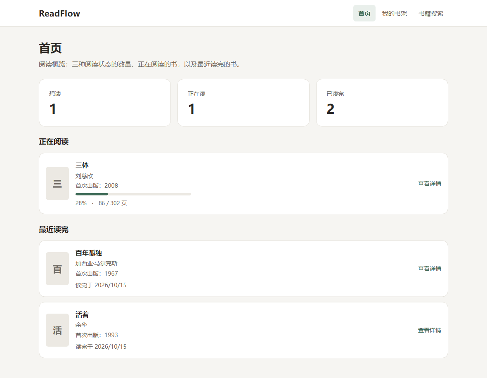
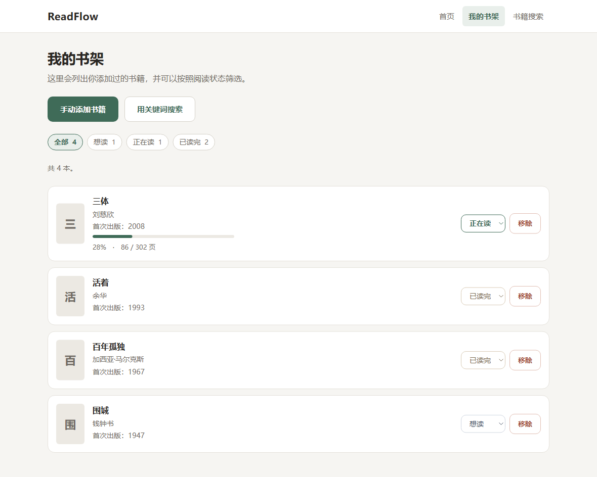
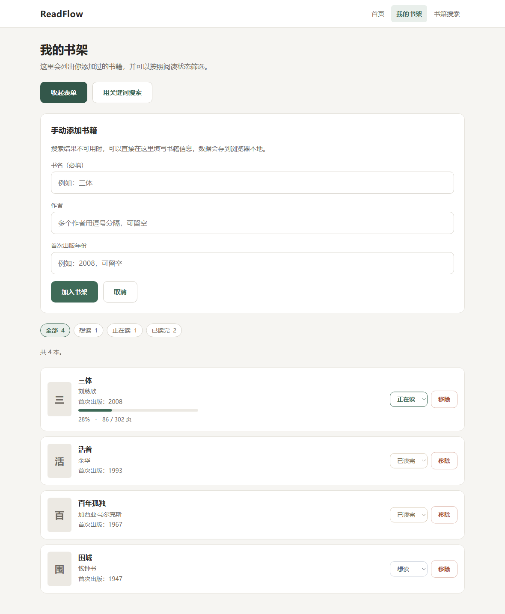

# ReadFlow

个人阅读管理应用。用来管理「想读 / 正在读 / 已读完」的书，记录每本书的阅读进度，保存自己的读书笔记。

**纯前端项目**：不需要后端服务，数据保存在浏览器本地。

> 这个项目的定位是「一个人自己用的阅读台账」，不是书库、不是社区。它的价值不在能搜到多少书，而在**记住我的阅读状态**。

## 技术栈

全部来自 `package.json` 与实际代码，没有使用其它框架或库：

| 技术 | 用途 |
| --- | --- |
| React 19 | 组件、Hooks、状态管理 |
| TypeScript 6（strict） | 类型约束，全项目没有使用 `any` |
| Vite 8 | 开发服务器与生产构建 |
| React Router 8 | 页面路由（声明式路由，未使用 loader/action） |
| 原生 CSS | 样式，用 CSS 变量统一颜色与间距；没有引入 UI 库或图标库 |
| localStorage | 数据持久化 |
| oxlint | 代码检查 |

运行时依赖只有 `react` / `react-dom` / `react-router` 三个。

## 核心功能

- **手动添加书籍**：在书架页填书名（必填）、作者、首次出版年份，加入书架。同名的书会按「书名 + 作者」识别为同一本，重复添加会被拦下。
- **书架管理**：按「全部 / 想读 / 正在读 / 已读完」筛选，每个筛选项显示对应的数量；点卡片进入详情页。
- **修改阅读状态**：在书架列表里直接通过下拉框切换状态，三个方向都可以自由切换。
- **阅读进度**：在详情页记录当前页数和总页数，保存后显示百分比和进度条。
- **阅读笔记**：每本书一份纯文本笔记，支持多行，点「保存笔记」才写入。
- **首页阅读概览**：三种状态的数量统计、正在阅读的书（含进度）、最近读完的 3 本书（含完成时间）。
- **本地数据持久化**：刷新或重开浏览器后数据仍在；本地数据损坏时会降级为空书架并提示，同时备份原始内容。

状态与进度的联动规则：标记为「已读完」时，如果总页数已知，当前页会自动补到总页数并记录完成时间；总页数未知时只改状态，不会编造进度。改回其它状态会清掉完成时间，但保留已记录的进度和笔记。

## 项目截图

### 首页：阅读概览



### 我的书架：筛选、状态切换、进度



### 书籍详情：阅读进度与读书笔记


### 手动添加书籍



> 截图来自实际运行的页面（1180px 宽，浏览器 2 倍缩放）。

## 快速开始

需要 Node.js 20.19+ 或 22.12+（Vite 8 的要求）。

```bash
# 1. 安装依赖
npm install

# 2. 启动开发服务器（默认 http://localhost:5173）
npm run dev

# 3. 类型检查 + 生产构建
npm run build

# 4. 本地预览构建产物
npm run preview

# 5. 代码检查
npm run lint
```

以上五个脚本都是 `package.json` 里实际存在的，没有其它自定义脚本。

## 数据存储与限制

数据保存在浏览器的 **localStorage** 里，键名是 `readflow:records:v1`，内容是一个图书记录数组的 JSON。

| 事项 | 说明 |
| --- | --- |
| 数据在哪 | 只在这台设备的这个浏览器里，按「浏览器 + 域名」隔离 |
| 刷新 / 重开浏览器 | 数据保留 |
| 清除浏览器站点数据 | **阅读记录会全部丢失，且无法恢复** |
| 换浏览器 / 换设备 / 无痕模式 | 看不到原来的数据 |
| 账号登录 | 不支持 |
| 云端同步 / 多设备同步 | 不支持 |
| 导入 / 导出 / 备份 | 不支持 |

补充两点实现上的边界：

- 本地数据**无法解析**时，应用不会崩溃：会按空书架启动、在页面顶部给出提示，并把无法解析的原文另存到 `readflow:records:v1.corrupted` 这个键里，避免被后续写入覆盖后彻底丢失。
- 浏览器禁用本地存储（例如某些无痕模式）时，应用仍可使用，但会提示「本次的阅读记录将无法保存」。

## 目录结构

```
ReadFlow/
├─ index.html
├─ package.json
├─ vite.config.ts            Vite 配置（含 /api/openlibrary 开发代理）
├─ tsconfig*.json
├─ public/
├─ docs/                     阶段报告、面试文档、截图
└─ src/
   ├─ main.tsx               入口：挂载 React + BrowserRouter
   ├─ App.tsx                路由表；在这里调用一次 useBooks() 并把数据下发给各页面
   ├─ types/reading.ts       ReadingStatus / BookMetadata / ReadingRecord
   ├─ hooks/useBooks.ts      书架数据的唯一来源与唯一写入口
   ├─ lib/
   │  ├─ storage.ts          localStorage 读写、字段级校验与容错
   │  ├─ reading.ts          单条记录的业务规则（状态联动、进度校验、百分比、格式化）
   │  ├─ stats.ts            集合级派生（统计数量、正在阅读、最近读完）
   │  ├─ manualBook.ts       手动录入的表单内容 → BookMetadata
   │  └─ openLibrary.ts      Open Library 搜索与数据映射（见下方已知限制）
   ├─ components/            AppLayout / BookListItem / CoverImage / ProgressBar / ReadingEditor
   └─ pages/                 HomePage / ShelfPage / SearchPage / BookDetailPage
```

分层原则：**`lib` 里的文件不 import React**，只做纯计算；页面组件不接触 localStorage。

## 已知限制

1. **在线图书搜索目前拿不到数据。** 搜索页和对应的请求代码（Vite 开发代理、字段映射、加载/失败/空结果三种状态）都已经实现，但这台机器所在网络对 `openlibrary.org` 存在 DNS 污染与 TLS 阻断，请求无法到达目标服务器。详情见 `docs/openlibrary-debug-report.md` 与 `docs/openlibrary-proxy-report.md`。**因此目前录入书籍的唯一方式是手动添加。**
2. **没有自动化测试。** 项目没有配置单元测试或 E2E 测试框架，验证方式是针对每个阶段在真实浏览器里逐条手工验收（记录在各阶段报告里）。
3. **没有 ErrorBoundary。** 已知的失败路径都在数据层处理了，但如果渲染阶段抛出未捕获异常，页面会变空白。
4. **首页的统计卡片不可点击**，只是展示数字；书架页的筛选条件也没有同步到 URL。
5. **详情页不能切换阅读状态**，需要回到书架页操作。
6. **书架侧边栏没有排序功能**，按加入顺序展示。

## 项目文档

| 文件 | 内容 |
| --- | --- |
| `docs/interview.md` | 面试讲解稿：项目介绍、核心技术实现、难点、局限、常见问题 |
| `docs/stage-*.md` | 各阶段的开发报告（做了什么、怎么验证的、未验证的部分） |
| `docs/openlibrary-*.md` | 关于在线搜索不可用问题的完整排查记录与代理配置报告 |
| `docs/screenshots/` | README 中引用的页面截图 |

## 开发说明

以下两节保留自项目初始化时使用的 Vite 模板，内容对当前配置依然适用。

### React Compiler

React Compiler 在模板中默认未启用，因为它会影响开发与构建性能。如需启用，参见 [React 官方文档](https://react.dev/learn/react-compiler/installation)。

### 关于 oxlint

项目使用 [oxlint](https://oxc.rs) 做代码检查，规则配置在 `.oxlintrc.json`：

```json
{
  "$schema": "./node_modules/oxlint/configuration_schema.json",
  "plugins": ["react", "typescript", "oxc"],
  "rules": {
    "react/rules-of-hooks": "error",
    "react/only-export-components": ["warn", { "allowConstantExport": true }]
  }
}
```

如果需要更严格的类型感知规则，可以安装 `oxlint-tsgolint` 并在配置里打开 `options.typeAware`。完整规则列表见 [Oxlint rules 文档](https://oxc.rs/docs/guide/usage/linter/rules)。
